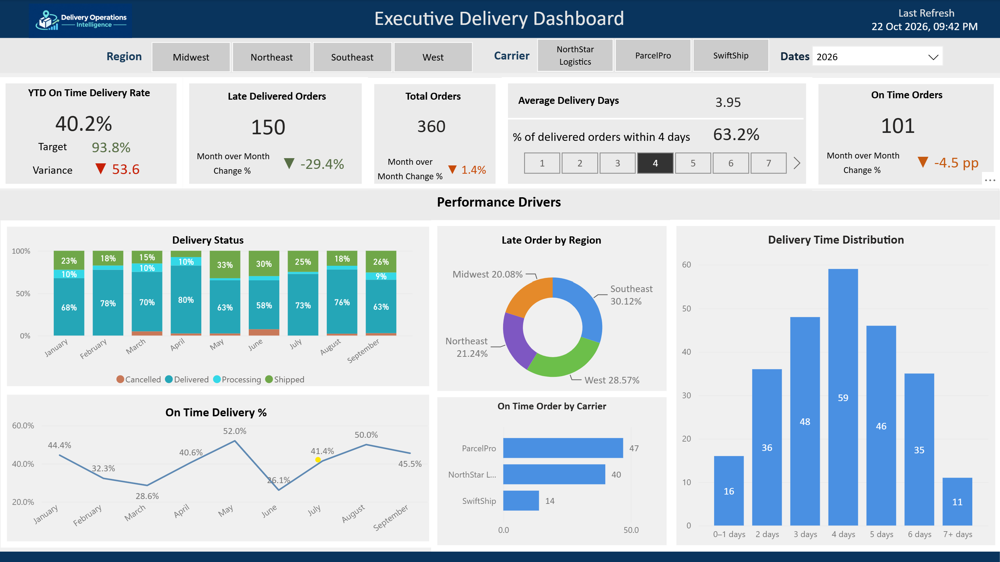

# Fabric Operations Intelligence

**Delivery Operations Intelligence | Microsoft Fabric | Power BI | Data Engineering | Business Intelligence**

## Project Overview

Delivery Operations Intelligence is a data analytics portfolio project built using Microsoft Fabric and Power BI.

The project demonstrates how delivery data can be ingested, transformed, organized into analytical tables, and presented through an interactive executive dashboard.

Using synthetic delivery data, the solution demonstrates a Lakehouse Medallion Architecture, PySpark-based data processing, curated Gold analytical tables, and Power BI Direct Lake reporting.

## Architecture

The solution follows a Medallion Architecture:

**Bronze → Silver → Gold → Power BI**

- **Bronze:** Ingests source data into Delta tables and maintains ingestion metadata, control information, and SHA-256 fingerprints for change detection.
- **Silver:** Applies data transformations, data type standardization, and data quality validation.
- **Gold:** Creates curated analytical tables for order-level delivery performance, daily delivery metrics, and carrier performance.
- **Power BI:** Uses a Direct Lake semantic model to support the Executive Delivery Dashboard.

## Technology Stack

- Microsoft Fabric
- OneLake and Fabric Lakehouse
- PySpark
- Delta Lake
- Fabric Data Pipelines
- Power BI
- Direct Lake

## Business Objectives

The project focuses on analyzing:

- On-time delivery performance
- Late orders and delivery exceptions
- Carrier performance against targets
- Regional delivery trends
- Delivery duration and operational efficiency

## Executive Dashboard Preview

## Repository Structure

| Folder | Contents |
|---|---|
| `fabric/` | Lakehouse, ingestion, transformation, orchestration, and semantic model documentation |
| `powerbi/` | Power BI report documentation and dashboard preview |
| `docs/` | Architecture, business requirements, data dictionary, KPI definitions, design decisions, deployment runbook, limitations, and implementation status |
| `sample-data/` | Synthetic CSV source datasets used for ingestion |
| `tests/` | Data validation and testing documentation |

## Documentation

- [Fabric Implementation](fabric/README.md)
- [Power BI Implementation](powerbi/README.md)
- [Power BI Report Overview](powerbi/report-overview.md)
- [Implementation Status](docs/implementation-status.md)
- [Architecture](docs/architecture.md)
- [Business Requirements](docs/business-requirements.md)
- [Data Dictionary](docs/data-dictionary.md)
- [KPI Definitions](docs/kpi-definitions.md)
- [Design Decisions](docs/design-decisions.md)
- [Limitations](docs/limitations.md)
- [Deployment Runbook](docs/deployment-runbook.md)
- [Data Validation](tests/README.md)
- [Sample Data](sample-data/README.md)

## Project Status

The following project components have been implemented:

- Fabric Lakehouse with Bronze, Silver, and Gold layers.
- Three PySpark processing notebooks.
- Fabric Data Pipeline configuration.
- Curated Gold analytical tables.
- Direct Lake semantic model.
- Executive Delivery Dashboard.
- Project architecture and implementation documentation.
- Notebook-level data validation.

### Pipeline Configuration

The Fabric pipeline is named `pl_delivery_medallion` and contains three notebook activities:

1. `nb_delivery_bronze_ingestion`
2. `nb_delivery_silver_transform`
3. `nb_delivery_gold_analytics`

Individual notebook executions completed successfully during implementation. A successful end-to-end pipeline execution has not yet been documented.

### Data Validation Results

The Bronze and Silver layers were validated against the synthetic source datasets.

| Dataset | Bronze Rows | Silver Rows |
|---|---:|---:|
| Orders | 1,320 | 1,320 |
| Customers | 89 | 89 |
| Delivery Events | 2,154 | 2,154 |
| Order Items | 2,632 | 2,632 |
| Carrier Targets | 12 | 12 |

The Gold analytical tables were validated with the following results:

| Metric | Validated Result |
|---|---:|
| Total orders | 1,320 |
| Delivered orders | 915 |
| On-time deliveries | 369 |
| Late deliveries | 546 |
| Daily metrics records | 1,132 |
| Carrier-region combinations | 12 |

The Gold tables include:

- `gold_delivery_performance` — order-level delivery performance.
- `gold_daily_delivery_metrics` — daily delivery metrics grouped by order date and region.
- `gold_carrier_performance` — carrier performance grouped by carrier and region.
- `dim_date` — continuous daily date dimension.

Daily and carrier-level aggregate metrics were cross-checked against the order-level Gold table.

## Project Scope and Limitations

This is a portfolio demonstration using synthetic data, not a production deployment.

Real-time streaming, production monitoring, automated alerting, CI/CD deployment, row-level security, and a formal automated testing framework have not been implemented.

The project demonstrates practical Microsoft Fabric and Power BI solution development, data engineering workflows, analytical modeling, and executive reporting.
