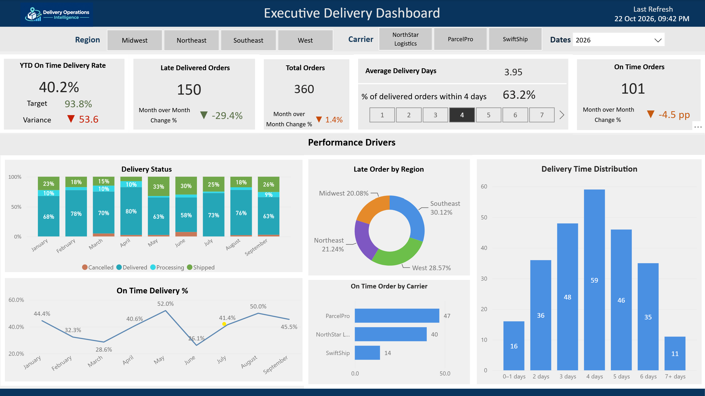

# Power BI Implementation

## Delivery Operations Intelligence Dashboard

This folder contains documentation and visual artifacts for the Power BI reporting component of the Delivery Operations Intelligence project.

## Executive Dashboard Preview

## Report Documentation

- [Power BI Report Overview](report-overview.md) – Dashboard KPIs, visualizations, interactive filters, data source, and business value.

## Semantic Model

The Power BI semantic model connects to the Microsoft Fabric Lakehouse using Direct Lake.

The model includes:

- `gold_delivery_performance`
- `gold_daily_delivery_metrics`
- `gold_carrier_performance`
- `dim_date`
- Supporting tables: `Measures`, `Delivery Status Legend`, and `Delivery Days Threshold`, and `Delivery Duration Bins`

Two date relationships are implemented:

- `dim_date[Date]` to `gold_daily_delivery_metrics[order_date]`
- `dim_date[Date]` to `gold_delivery_performance[order_date]`

The `gold_carrier_performance` table is not currently related to `dim_date`. Therefore, the Year slicer does not filter carrier performance through the date dimension.

For implementation details, see [Fabric Semantic Model Documentation](../fabric/semantic-model.md).

## Executive Delivery Dashboard

The report includes:

- Year-to-date on-time delivery rate and target.
- On-time delivery variance.
- Late orders and total orders.
- Average delivery days and on-time orders.
- Delivery status distribution.
- Regional and carrier performance.
- Monthly delivery performance trends.
- Delivery duration distribution.

Interactive slicers are available for Region, Carrier, and Year.

The current report contains one Executive Delivery Dashboard page. Drillthrough and drilldown functionality are not implemented.

## Implementation Scope

The current implementation covers one Executive Delivery Dashboard page and its semantic model.

The dashboard preview is available in `executive-overview.png`. Additional screenshots and validation evidence may be added as the project evolves.

## Security and Data Validation

**Storage mode:** Direct Lake.

Data validation was performed across the Bronze, Silver, and Gold layers. Gold-level daily and carrier aggregates were cross-checked against the order-level Gold table.

Refresh configuration and security testing have not been documented as verified implementation capabilities.

Do not include credentials, confidential information, or unsupported implementation claims.
